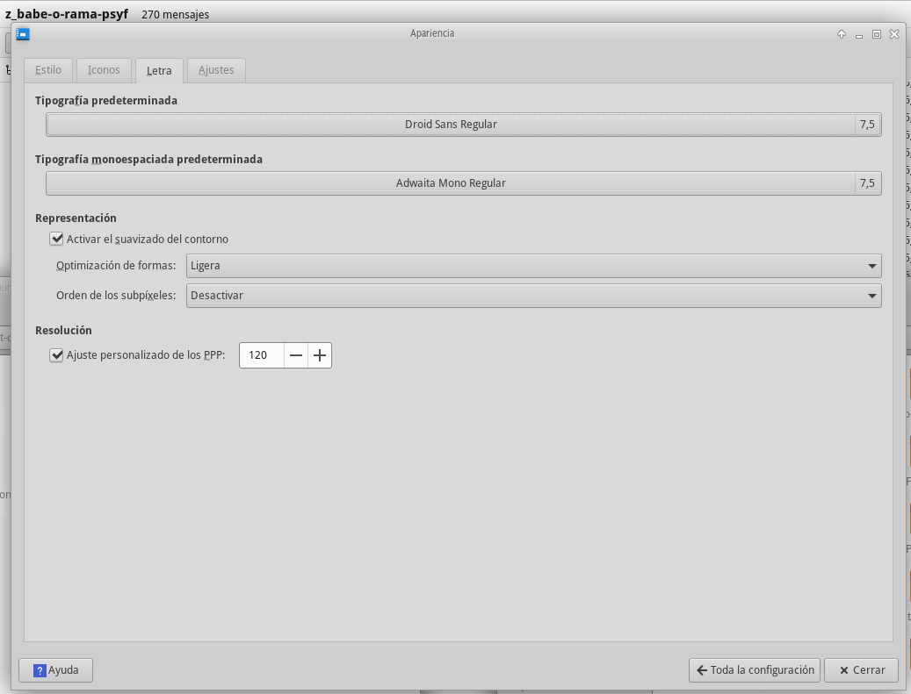
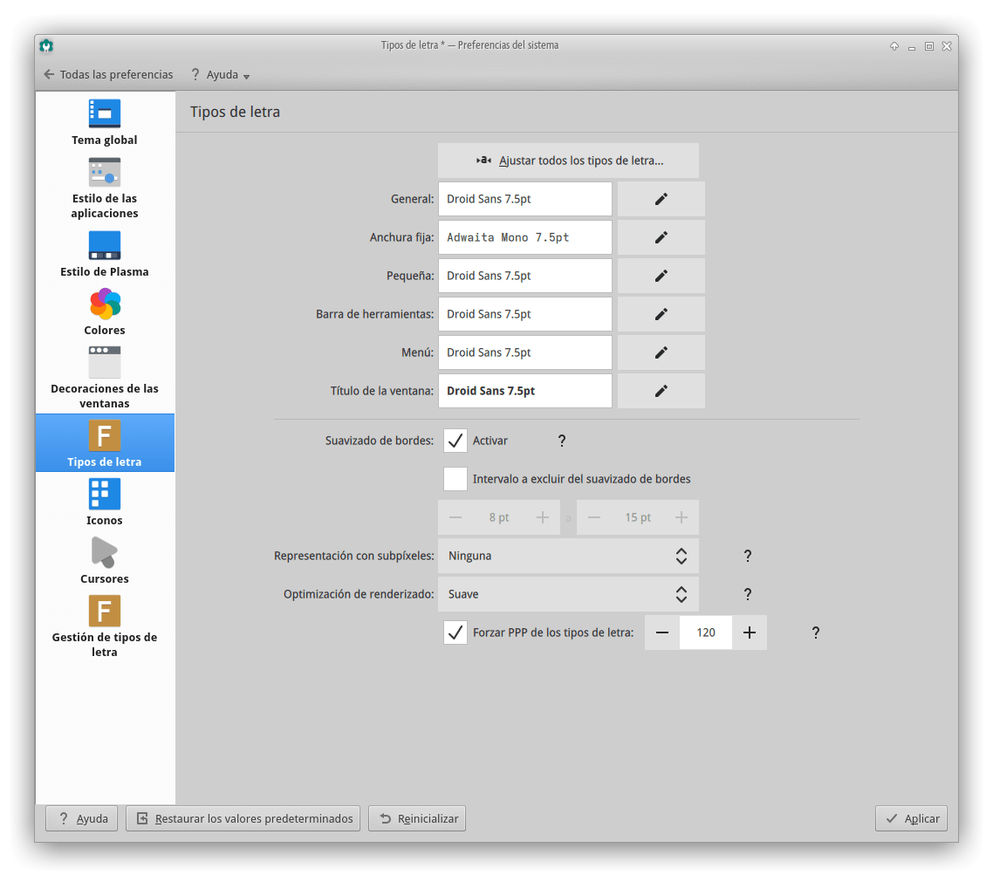

# Fonts

Nice and extremely well-made fonts for your desktop.

I recommend the following fonts (in order of preference):

- **Desktop/Apps/Regular Fonts**:
	1. Adwaita Regular
	2. Droid Sans
	3. Fira Sans
	
- **Terminal/Code/Monospace Fonts**:
	1. Adwaita Mono
	2. JetBrains Mono
	3. Pragmasevka and IosVmata (*)
	3. Fira Mono

By selecting the appropriate font, you can achieve a beautiful appearance and improved legibility.

* - IosVmata is a more spaced Pragmasevka version (and has a nerd version too. See more info at [nerd-fonts](https://github.com/ryanoasis/nerd-fonts) ).

## Installation

Unzip the 7zip files, and you will obtain folders containing the font files.

**For your user:**

Copy to `/home/<user>/.fonts`

**For all users:**

Copy to `/usr/share/fonts/`

That's all, folks!

## fonts.conf

A configuration file of font rendering to copy into:
`/home/<user>/.config/fontconfig/`

It only sets:

- Antialiasing: on
- Hinting: slight (`hintslight`)

Nothing else: DPI, subpixel order and fonts are **desktop** settings, not
fontconfig ones. They depend on your screen, so configure them in your
desktop environment (XFCE: *Apariencia → Letra*).

## XFCE Configuration

`install.sh` applies these XFCE settings via `xfconf-query` (skip with
`SKIP_XFCONF=1`; they are skipped automatically when not running XFCE
or when running as root):

- Default font: Droid Sans 7.5
- Default monospace font: Adwaita Mono 7.5
- Antialiasing: on
- Hinting: slight
- Subpixel order: off (grayscale)
- Custom DPI: 120

Adjust DPI and subpixel order to your screen in *Apariencia → Letra*.

## Toolkit Coverage (GTK and Qt)

How font rendering and typography resolve per toolkit under XFCE:

| Toolkit | Rendering (AA / hinting / DPI) | Typography (font family + size) |
|---------|-------------------------------|--------------------------------|
| GTK2    | XSETTINGS (xfsettingsd)       | XSETTINGS (xfsettingsd)        |
| GTK3    | XSETTINGS (xfsettingsd)       | XSETTINGS (xfsettingsd)        |
| GTK4    | XSETTINGS (xfsettingsd)       | XSETTINGS (xfsettingsd)        |
| Qt5     | X resources (`Xft.*`) + fontconfig | `qt5ct` (`QT_QPA_PLATFORMTHEME=qt5ct`) |
| Qt6     | X resources (`Xft.*`) + fontconfig | `qt6ct` (registers itself as `qt5ct`)  |

`install.sh` covers the Qt side:

- Copies `qt5ct.conf` / `qt6ct.conf` (Droid Sans 7.5 / Adwaita Mono 7.5)
  into `~/.config/qt5ct/` / `~/.config/qt6ct/` only if missing (existing
  custom configs are kept)
- Sets `export QT_QPA_PLATFORMTHEME=qt5ct` in `~/.xsessionrc` and
  `~/.profile` (idempotent). `~/.xsessionrc` is sourced by Xsession for the
  whole session, so it also overrides an unwanted value from
  `/etc/environment` (e.g. `gtk2`, which Qt6 ignores)
- Adds the `Xft.*` block to `~/.Xresources` and merges it with `xrdb`
  (belt and braces for apps that only read X resources)
- Installs the `qt5ct` / `qt6ct` packages when missing (via `apt-get`,
  using `sudo` when needed; otherwise it prints the command to run)

Re-login required to apply the environment changes to every application.
Skip the whole Qt block with `SKIP_QT=1`.

## KDE/Plasma Configuration

